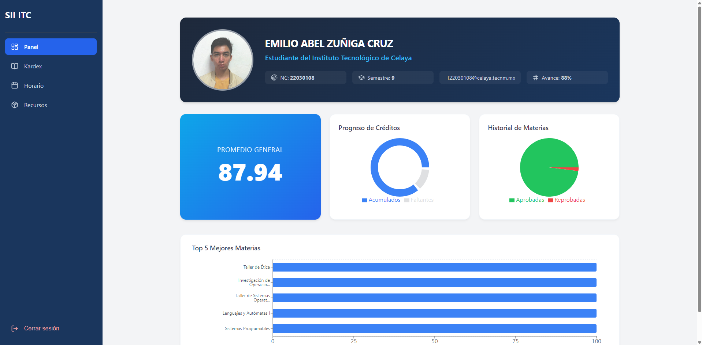
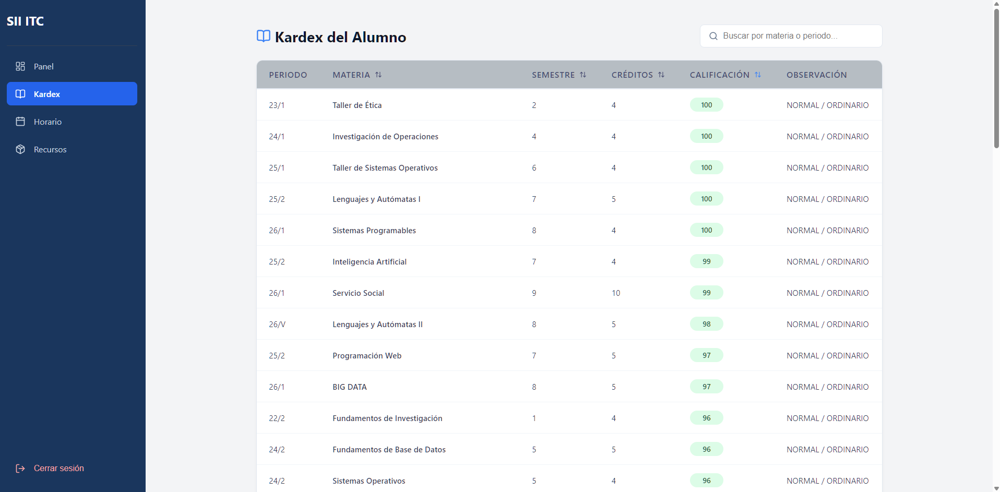
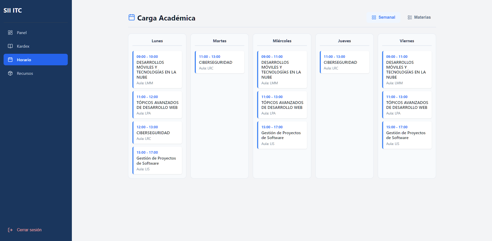
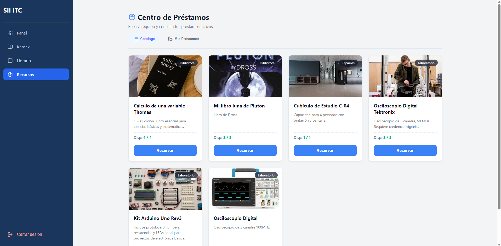
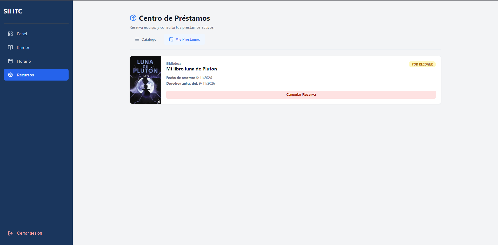

# Aplicación Académica SII ITC — Examen 3

Aplicación web para consultar perfil académico, Kardex, calificaciones por parcial y horario del SII ITC. Incluye un Centro de Préstamos para consultar recursos, solicitar préstamos y gestionar su inventario.

Aplicación en Render: [https://api-itc-frontend.onrender.com/login](https://api-itc-frontend.onrender.com/login).

## Tecnologías utilizadas

| Tecnología | Uso |
|---|---|
| React + TypeScript | Interfaz organizada en componentes con tipado estático. |
| Vite | Servidor de desarrollo y compilación del frontend. |
| React Router | Navegación entre las pantallas de la aplicación. |
| Node.js + Express + TypeScript | API propia, autenticación e integración con el SII ITC. |
| Supabase PostgreSQL | Almacenamiento de sesiones, recursos y préstamos. |

El proyecto contiene dos aplicaciones: `frontend/` y `backend/`, administradas con workspaces de npm. El frontend consulta exclusivamente nuestro backend; este se comunica con la API institucional. Las sesiones utilizan una cookie `httpOnly` y el token institucional permanece en el servidor. Frontend y backend se despliegan por separado en Render.

## Instalación

### Requisitos

- Node.js versión 22, 23 o 24 y npm.
- Acceso al proyecto Supabase del equipo, con sus tablas de sesiones, recursos y préstamos ya configuradas.
- Una cuenta institucional para iniciar sesión.

Abre una terminal en la raíz del repositorio y ejecuta:

```powershell
npm install

if (-not (Test-Path backend/.env)) {
    Copy-Item backend/.env.example backend/.env
}

if (-not (Test-Path frontend/.env)) {
    Copy-Item frontend/.env.example frontend/.env
}
```

### Configuración del backend

En `backend/.env`, habilita las variables comentadas que correspondan y completa:

| Variable | Valor para desarrollo local |
|---|---|
| `NODE_ENV` | `development` |
| `PORT` | `3000` |
| `FRONTEND_ORIGIN` | `http://localhost:5173` |
| `COOKIE_SECURE` | `false` |
| `COOKIE_SAME_SITE` | `lax` |
| `SUPABASE_URL` | URL del proyecto Supabase del equipo. |
| `SUPABASE_SECRET_KEY` | Clave de servidor del proyecto Supabase. |
| `SII_TOKEN_ENCRYPTION_KEY` | Llave Base64 de 32 bytes utilizada por el backend del equipo. |
| `SII_API_BASE_URL` | `https://sii.celaya.tecnm.mx` |

Conserva las demás opciones de la plantilla. Si se comparte la base de sesiones, utiliza la misma llave de cifrado del equipo. Solicita los valores privados por un canal seguro; no subas los archivos `.env` al repositorio.

### Configuración del frontend

En `frontend/.env`, configura:

```dotenv
VITE_API_URL=http://localhost:3000
VITE_ADMIN_CONTROL_NUMBER=
```

Completa `VITE_ADMIN_CONTROL_NUMBER` con el número de control de la cuenta que muestra la interfaz administrativa del Centro de Préstamos. Esta opción controla la visualización de la interfaz; las variables `VITE_*` son públicas y no deben contener secretos.

## Ejecución

Desde la raíz del repositorio, inicia el backend:

```powershell
npm run dev:backend
```

En una segunda terminal, también desde la raíz, inicia el frontend:

```powershell
npm run dev:frontend
```

Abre [http://localhost:5173](http://localhost:5173) e inicia sesión con tu cuenta institucional. Mantén ambas terminales abiertas y utiliza `localhost` en las dos direcciones. Puedes comprobar el backend en [http://localhost:3000/health](http://localhost:3000/health).

Si modificas los archivos `.env`, reinicia el servicio correspondiente.

Para compilar ambas aplicaciones:

```powershell
npm run build
```

## Capturas de pantalla

### Inicio de sesión


### Perfil y resumen académico



### Kardex



### Horario y calificaciones por parcial



### Centro de Préstamos



### Reserva de recursos


